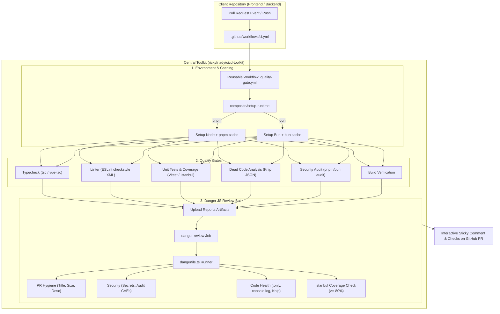
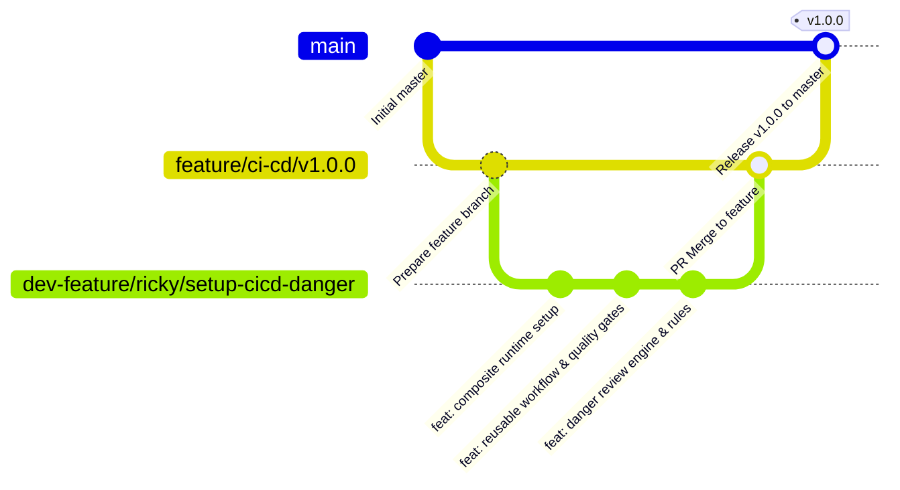

# CI/CD Toolkit & Danger Review Engine

[](https://github.com/rickyfriady/cicd-toolkit)
[](https://opensource.org/licenses/MIT)

Standardized, decacorn-grade CI/CD and pull request automated code review engine for GitHub repositories. Designed to be consumed effortlessly by both frontend (Vue 3, React, Vite) and backend (Node.js, Bun) projects.

---

## Architecture Overview



---

## Git & Branching Strategy



---

## Features & Quality Gates

### 1. Reusable Workflow (`quality-gate.yml`)
- **Multi-Runtime & Multi-PM:** Seamlessly supports both `pnpm` and `bun` with automated runtime detection and store/dependency caching.
- **Concurrency Control:** Cancels stale running workflows automatically when a new commit is pushed (`cancel-in-progress: true`), saving GitHub Action minutes.
- **Parallel Quality Gates:**
  - TypeScript Typecheck (`tsc --noEmit` / `vue-tsc`)
  - ESLint analysis (exported to checkstyle XML for Danger bot integration)
  - Vitest / Istanbul unit test execution with coverage export (`reports/unit/coverage/lcov.info`)
  - Dead code & unused dependencies detection via **Knip**
  - Dependency vulnerability scan via `pnpm audit` / `bun audit`
  - Production build verification

### 2. Modular Danger Review Engine (`dangerfile.ts`)
- **PR Hygiene:**
  - Enforces ticket formatting in titles (e.g., `[PROJ-123]` or Conventional Commits `feat: ...`).
  - Checks minimum PR description length and details.
  - Warns on oversized pull requests (> 400 lines) to encourage modular diffs.
- **Security & Secret Leak Guard:**
  - Blocks committed private keys (`.pem`, `.key`, `id_rsa`), certificates, and `.env` files.
  - Alerts on modified critical infrastructure files (`.npmrc`, Dockerfiles, workflows).
  - Evaluates audit results and blocks merges on **Critical** or **High** severity vulnerabilities.
- **Code Health & Safety:**
  - Blocks residual `console.log`, `debugger`, and `alert` statements in production code (`src/`).
  - Blocks static inline HTML styles (enforcing design tokens and Tailwind CSS).
  - Detects and blocks `.only` or `.skip` test suites (`it.only`, `test.skip`, `fit`, `fdescribe`).
  - Verifies lockfile synchronization (`package.json` vs `pnpm-lock.yaml` / `bun.lockb`).
  - Flags unresolved imports and unused packages via Knip.
- **Test Coverage:**
  - Enforces a minimum **80% coverage threshold** on statements, branches, functions, and lines.
- **Bundle Size & Asset Budget Guard:**
  - Scans `dist/` production assets and computes raw vs estimated gzip sizes.
  - Warns on single assets exceeding `maxAssetSizeKB` (default: 350 KB) or total bundle exceeding budget (default: 1500 KB).
- **Deep Secret Scanning & License Compliance:**
  - High-entropy credential detector scanning diffs for AWS keys, OpenAI keys, Slack webhooks, and private certificates.
  - Dependency license compliance checker blocking viral copyleft licenses (GPL, AGPL) in commercial repositories.

### 3. Enterprise Automation Workflows
- **Cross-Environment Matrix Testing:** Supports parallel verification across multiple Node.js versions (e.g. Node 20.x LTS & Node 22.x).
- **Reusable PR Preview Deployment (`preview-deploy.yml`):** Automatically creates ephemeral preview deployments for PRs and comments the live URL directly on the PR thread.
- **Automated Semantic Release (`release.yml`):** Inspects Conventional Commits upon merge to `master`, determines semantic bump (`patch` / `minor` / `major`), cuts a new Git Tag, and publishes GitHub Release notes.

---

## Quick Start (How to Use in Your Repo)

In your client repository (e.g. Vue 3 + Vite or Backend service), create `.github/workflows/ci.yml`:

```yaml
name: CI Pipeline

on:
  push:
    branches: [main, staging, development]
  pull_request:
    branches: [main, staging, development]

concurrency:
  group: ${{ github.workflow }}-${{ github.ref }}
  cancel-in-progress: true

jobs:
  quality-gate:
    name: "Enterprise Quality Gate"
    uses: rickyfriady/cicd-toolkit/.github/workflows/quality-gate.yml@v1
    with:
      package-manager: "pnpm" # 'pnpm' | 'bun' | 'auto'
      node-version: "22.x"
      coverage-threshold: 80
      run-knip: true
      run-audit: true
      build-script: "build"
      danger-enabled: true
    secrets: inherit
```

---

## Configuration (`.dangerrc.json`)

To customize Danger rules for your project, add an optional `.dangerrc.json` in your repository root:

```json
{
  "ticketPattern": "^\\[[A-Za-z0-9_-]+\\]|^(\\w+(\\([\\w-]+\\))?:)",
  "minDescriptionLength": 50,
  "maxChangedLines": 400,
  "maxChangedFiles": 50,
  "enforcePackageVersion": false,
  "coverageThreshold": 80,
  "blockConsole": true,
  "blockInlineStyles": true
}
```

---

## GitHub Permissions

Danger requires permission to comment on Pull Requests. In your client repository:
1. Go to **Settings** > **Actions** > **General** > **Workflow permissions**.
2. Select **Read and write permissions** (or ensure the workflow grants `pull-requests: write`).

---

## License

MIT © [Ricky Friadi](https://github.com/rickyfriady)
