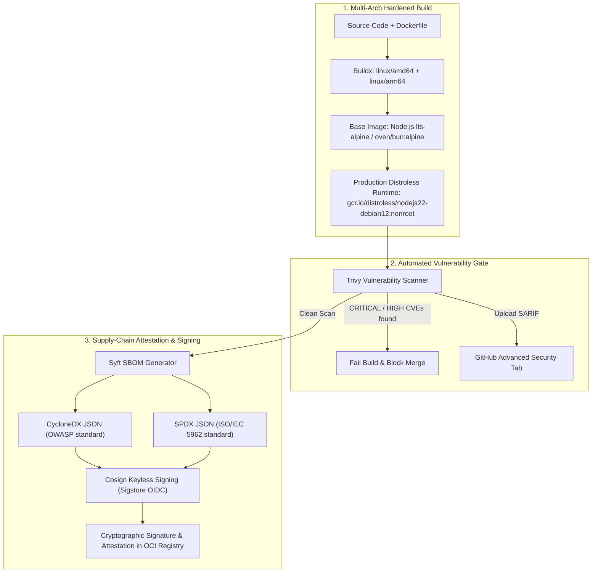

# Container Security & Hardening Guide

Modern cloud-native and fintech microservices require defense-in-depth container security. This document details the zero-trust container security architecture provided by `rickyfriady/cicd-toolkit`.

---

## Architecture Overview



---

## 1. Distroless Container Architecture

Standard container base images (such as Ubuntu, Debian, or even Alpine) often package package managers (`apk`, `apt`), shell utilities (`sh`, `bash`), and network downloaders (`curl`, `wget`). In production, an attacker who achieves Remote Code Execution (RCE) can leverage these binaries for living-off-the-land attacks.

### Why Google Distroless?
- **Zero Package Managers:** No `apt` or `apk` to install malicious tools.
- **Zero Shells:** No `/bin/sh` or `/bin/bash` to execute reverse shells.
- **Non-Root Execution:** Preconfigured with unprivileged user `nonroot` (UID `65532`).
- **Minimal CVE Surface:** Eliminates 90%+ of typical base image operating system vulnerabilities.

### Reference Node.js Distroless Multi-Stage Dockerfile
See [`examples/distroless-node/Dockerfile`](../examples/distroless-node/Dockerfile):

```dockerfile
# Stage 1: Builder (Node.js Alpine LTS + pnpm LTS)
FROM node:lts-alpine AS builder

WORKDIR /app

# Enable Corepack and pnpm LTS (12.15.0)
RUN corepack enable && corepack prepare pnpm@12.15.0 --activate

# Cache dependencies
COPY package.json pnpm-lock.yaml ./
RUN pnpm install --frozen-lockfile

# Build application
COPY . .
RUN pnpm run build

# Prune dev dependencies
RUN pnpm prune --prod

# Stage 2: Distroless Production Runtime
FROM gcr.io/distroless/nodejs22-debian12:nonroot AS runner

WORKDIR /app
ENV NODE_ENV=production
ENV PORT=3000

# Copy only runtime dependencies and compiled output
COPY --from=builder --chown=nonroot:nonroot /app/node_modules ./node_modules
COPY --from=builder --chown=nonroot:nonroot /app/package.json ./package.json
COPY --from=builder --chown=nonroot:nonroot /app/dist ./dist

# Enforce non-root execution
USER nonroot
EXPOSE 3000
CMD ["dist/index.js"]
```

---

## 2. Automated Vulnerability Scanning with Trivy

The reusable workflow executes **Aqua Security Trivy** against the compiled image before pushing to registry:

1. **Severity Filtering:** Configurable via `scan-severity` (default: `CRITICAL,HIGH`).
2. **SARIF Output:** Uploads `trivy-results.sarif` to the GitHub repository's **Security** > **Code Scanning alerts** tab for automated triage and auditing.
3. **Hard Gate:** If `fail-on-cve: true`, the pipeline terminates immediately with an error exit code, preventing vulnerable images from ever reaching the registry.

---

## 3. Software Bill of Materials (SBOM)

An SBOM provides an authoritative, transparent manifest of every operating system package, language runtime, and nested dependency present in a container image.

Our workflow runs **Anchore Syft** to generate two industry-standard formats:
- **CycloneDX JSON:** The OWASP-backed standard for software vulnerability tracking and compliance.
- **SPDX JSON:** The ISO/IEC 5962 international standard for open-source license and component auditing.

Both SBOM files are uploaded as pipeline build artifacts (`sbom-cyclonedx.json`, `sbom-spdx.json`) and attached directly to the container image via Cosign.

---

## 4. Keyless Cryptographic Signing with Cosign & Sigstore

Traditional container signing requires managing long-lived private keys, which introduces key leakage and rotation hazards.

Our toolkit uses **Cosign Keyless Signing** powered by **Sigstore**:
1. **GitHub OIDC Token:** The workflow requests a short-lived OpenID Connect token from GitHub Actions (`id-token: write`).
2. **Fulcio Certificate Authority:** Sigstore's Fulcio CA verifies GitHub's identity (repository, workflow, SHA) and issues a short-lived certificate.
3. **Rekor Transparency Log:** The signature and certificate are recorded immutably in the Rekor public ledger.
4. **Signature & Attestation Attachment:** Cosign pushes signature layers directly to GHCR or Docker Hub alongside the container.

### How to Verify Signatures Locally or in Kubernetes
Anyone or any admission controller (such as Kyverno or Gatekeeper) can verify your container image using Cosign:

```bash
# Verify container image signature
cosign verify \
  --certificate-identity-regexp "https://github.com/rickyfriady/.*" \
  --certificate-oidc-issuer "https://token.actions.githubusercontent.com" \
  ghcr.io/rickyfriady/my-fintech-service:v1.0.0

# Verify SBOM attestation
cosign verify-attestation \
  --type cyclonedx \
  --certificate-identity-regexp "https://github.com/rickyfriady/.*" \
  --certificate-oidc-issuer "https://token.actions.githubusercontent.com" \
  ghcr.io/rickyfriady/my-fintech-service:v1.0.0
```
