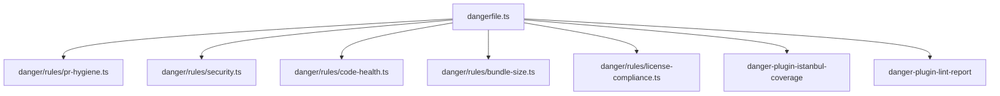

# Danger Review Engine Guide

The **Danger Review Engine** (`dangerfile.ts`) provides decacorn-grade, automated pull request governance for GitHub repositories. It reviews PRs like a senior staff engineer, enforcing hygiene, security, code health, test coverage, and performance budgets directly in the PR thread.

---

## Visual PR Comment Layout

Danger generates an interactive, consolidated sticky comment updated with every new commit:

```markdown
<div align="center">

### 🛡️ Ricky Friadi CI/CD Review Engine
**Decacorn-Grade Code Governance & Automated Quality Gate**

---
</div>

## 🛡️ Dependency Vulnerability Report
Totals: 0 critical / 0 high / 0 moderate / 0 low
✅ No known security vulnerabilities in installed dependencies.

## 🗑️ Knip Code Health Report
### Summary
| Issue Type | Severity | Count |
| :--- | :--- | ---: |
| Unused Dependencies | 🚨 fail | 0 |
| Unused Exports | ⚠️ warn | 0 |
| **Total** | | **0** |

✅ Knip: No unused code, dependencies, or unresolved imports detected.

---
<div align="right">
<sub>Reviewed with ❤️ by <b>Ricky Friadi CI/CD Toolkit</b> • Standardized Quality Gates</sub>
</div>
```

---

## Rule Modules (`danger/rules/`)

Danger's rules are completely modularized in TypeScript:



### 1. PR Hygiene (`pr-hygiene.ts`)
- **Ticket / Conventional Commit Enforcement:** Validates PR title against regex `ticketPattern` (e.g. `[PROJ-123]` or `feat: ...`).
- **PR Description Quality:** Checks that description length meets `minDescriptionLength` (default: 50 characters).
- **Oversized PR Alerts:** Warns when changed lines exceed `maxChangedLines` (default: 400 lines) or files exceed `maxChangedFiles` (default: 50 files) to encourage modular PRs.
- **Assignee & Reviewer Check:** Alerts if no assignee is set.
- **Source vs Test Diff Alignment:** Warns if source files under `src/` are modified without corresponding `*.spec.ts` or `*.test.ts` modifications.

### 2. Security Guard & Vulnerability Audit (`security.ts`)
- **Committed Secret Detection:** Scans added file paths for `.pem`, `.key`, `.p12`, `.pfx`, `.crt`, `.env*`, and SSH keys (`id_rsa`). Merging is blocked immediately.
- **Critical Infrastructure Alerts:** Warns when sensitive infra files are touched (`.github/workflows`, `Dockerfile`, `.npmrc`, `.pnpmrc`).
- **Dependency CVE Audit:** Parses `reports/dependencies/audit.json` (`pnpm audit` / `bun audit`), outputs formatted table with severity badges:
  - `🟣 CRITICAL`: Blocker (`fail`)
  - `🔴 HIGH`: Blocker (`fail`)
  - `🟠 MODERATE`: Warning (`warn`)
  - `🟡 LOW`: Informational badge (`markdown`)

### 3. Code Health & Dead Code (`code-health.ts`)
- **Lockfile Synchronization:** Detects if `package.json` changed without corresponding lockfile (`pnpm-lock.yaml`, `bun.lockb`, `package-lock.json`).
- **Focused & Skipped Tests:** Blocks merges containing `.only` (`it.only`, `describe.only`, `fit`) and warns on `.skip`.
- **Production Cleanliness:** Blocks raw `console.log`, `debugger`, and `alert` calls in `src/`.
- **Inline Style Guard:** Blocks static `style="..."` attributes to enforce Tailwind CSS / design tokens.
- **Knip Multi-Section Report:** Parses `reports/knip/knip-result.json` across 13 categories:
  - `dependencies`: Unused packages (`🚨 fail`)
  - `devDependencies`: Unused dev packages (`🚨 fail`)
  - `unlisted`: Imported but missing from `package.json` (`🚨 fail`)
  - `unresolved`: Broken import specifiers (`🚨 fail`)
  - `exports`: Unused exports (`⚠️ warn`)
  - `types`: Unused exported types (`⚠️ warn`)
  - `files`: Unused files (`⚠️ warn`)

### 4. Bundle Size & Performance Budget (`bundle-size.ts`)
- Scans `dist/` production assets and computes raw vs estimated gzip sizes.
- Compares individual assets against `maxAssetSizeKB` (default: 350 KB).
- Compares total bundle against `maxBundleSizeKB` (default: 1500 KB).

### 5. License Compliance (`license-compliance.ts`)
- Scans dependency licenses and blocks viral copyleft licenses (`GPL-2.0`, `GPL-3.0`, `AGPL-3.0`, `SSPL`) in commercial/proprietary applications.

### 6. Test Coverage Gate
- Powered by `danger-plugin-istanbul-coverage`.
- Requires Istanbul / Vitest lcov coverage file at `reports/unit/coverage/lcov.info`.
- Fails build if lines, statements, functions, or branches fall below `coverageThreshold` (default: 80%).

---

## Configuration Contract (`.dangerrc.json`)

To override defaults in your repository, place a `.dangerrc.json` in the root of your project:

```json
{
  "ticketPattern": "^\\[[A-Za-z0-9_-]+\\]|^(\\w+(\\([\\w-]+\\))?:)",
  "minDescriptionLength": 50,
  "maxChangedLines": 400,
  "maxChangedFiles": 50,
  "enforcePackageVersion": false,
  "coverageThreshold": 80,
  "maxAssetSizeKB": 350,
  "maxBundleSizeKB": 1500,
  "blockConsole": true,
  "blockInlineStyles": true,
  "allowedLicenses": [
    "MIT",
    "Apache-2.0",
    "BSD-2-Clause",
    "BSD-3-Clause",
    "ISC",
    "0BSD"
  ]
}
```

---

## Local Testing
You can run Danger locally against any open Pull Request before pushing:

```bash
# Set temporary read-only token
export DANGER_GITHUB_API_TOKEN="ghp_yourToken"

# Run Danger against PR #2
pnpm exec danger pr https://github.com/rickyfriady/cicd-toolkit/pull/2
```
