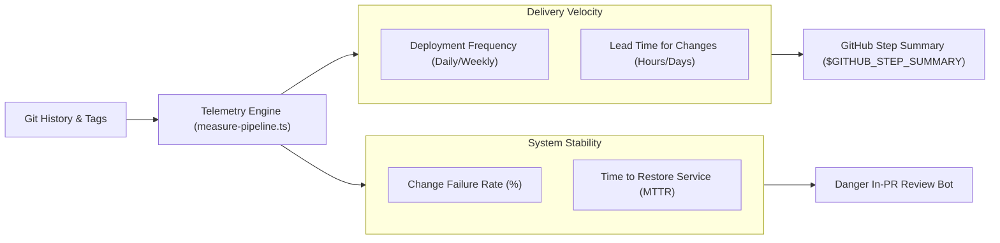

# 360° DORA Metrics & CI Pipeline Telemetry

Production-grade engineering velocity, release cadence, and reliability telemetry engine for `@rickyfriady/cicd-toolkit`.

---

## 1. Overview & Objectives

High-performing engineering teams require objective data to balance speed and stability. Based on Google Cloud's DevOps Research and Assessment (DORA) framework, this toolkit provides automated, continuous calculation and reporting of the **Four Key Metrics**:

1. **Deployment Frequency (DF)**: Cadence of successful releases pushed to production.
2. **Lead Time for Changes (LT)**: Time required for a commit to be merged, verified, and released.
3. **Change Failure Rate (CFR)**: Percentage of releases that result in degraded service or hotfix interventions.
4. **Time to Restore Service (MTTR)**: Time elapsed between a release incident/hotfix commit and production remediation.



---

## 2. Industry Benchmark Tiers (2024 DORA Criteria)

| Metric | 🟢 Elite Tier | 🔵 High Tier | 🟡 Medium Tier | 🔴 Low Tier |
| :--- | :---: | :---: | :---: | :---: |
| **Deployment Frequency** | On-demand (multiple/day) | Once per day to weekly | Once per week to monthly | Fewer than once per month |
| **Lead Time for Changes** | Less than 1 day | 1 day to 1 week | 1 week to 1 month | More than 1 month |
| **Change Failure Rate** | 0% - 15% | 16% - 30% | 31% - 45% | More than 45% |
| **Time to Restore (MTTR)** | Less than 1 hour | Less than 1 day | Less than 1 week | More than 1 week |

---

## 3. Telemetry CLI Engine

The telemetry engine runs with zero external cloud dependencies by parsing git commit history and semantic tags:

```bash
# Calculate DORA metrics and write reports/telemetry/dora-metrics.json
pnpm run telemetry:measure

# Append formatted scorecard to GitHub Actions Step Summary
pnpm run telemetry:measure -- --step-summary
```

### Generated Artifact Schema (`reports/telemetry/dora-metrics.json`)

```json
{
  "calculatedAt": "2026-11-03T08:35:11.608Z",
  "overallTier": "High",
  "metrics": {
    "deploymentFrequency": {
      "value": "2 releases recorded",
      "tier": "High",
      "details": "Between once per day and once per week"
    },
    "leadTimeForChanges": {
      "value": "132.4 hours",
      "tier": "High",
      "details": "1 day - 1 week"
    },
    "changeFailureRate": {
      "value": "0%",
      "tier": "Elite",
      "details": "0 hotfix / remediations across 2 releases"
    },
    "timeToRestoreService": {
      "value": "0.5 hours",
      "tier": "Elite",
      "details": "Less than 1 hour"
    }
  }
}
```

---

## 4. GitHub Actions Workflow Integration

Include `.github/workflows/pipeline-metrics.yml` as a reusable step in deployment and release workflows:

```yaml
jobs:
  telemetry:
    name: "DORA Pipeline Telemetry"
    uses: rickyfriady/cicd-toolkit/.github/workflows/pipeline-metrics.yml@v1
    with:
      publish-summary: true
```

---

## 5. In-PR Code Review Telemetry Card

The Danger review engine automatically incorporates PR commit lead time and change blast radius directly into code review comments:

| Velocity Dimension | PR Measurement | Governance Assessment |
| :--- | :---: | :--- |
| **Commit Lead Time** | `1.4h` | 🟢 Rapid Delivery (< 24h) |
| **Commit Volume** | `3 commit(s)` | 🟢 Well-Scoped Pull Request |
| **Change Blast Radius** | `5 file(s)` | 🟢 Contained Blast Radius |
