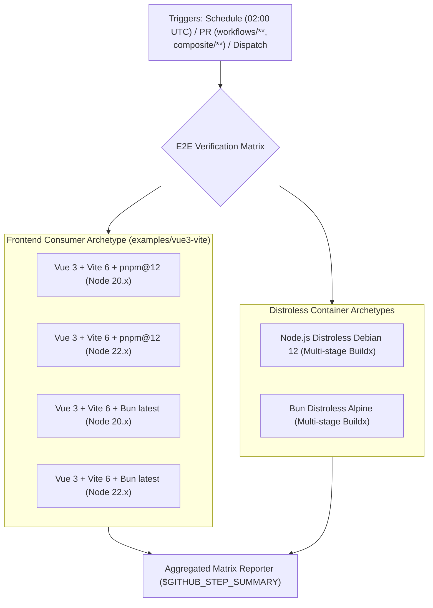

# Comprehensive E2E Cross-Framework Consumer Verification

Production-grade cross-framework and multi-runtime continuous verification engine for `@rickyfriady/cicd-toolkit`.

---

## 1. Overview & Architecture

Reusable GitHub Actions workflows and composite actions must be resilient across varying consumer architectures, package managers, and Node.js LTS engines. The E2E Verification Engine automatically simulates real downstream consumer lifecycles without requiring external repositories.



---

## 2. Test Matrix Topology

| Dimension | Permutations Covered | Purpose |
| :--- | :--- | :--- |
| **Frameworks** | Vue 3 + Vite 6 Single Page App | Verifies client-side bundling, asset generation, and build scripts. |
| **Containers** | `gcr.io/distroless/nodejs22-debian12:nonroot`, `oven/bun:alpine` | Verifies multi-stage BuildKit caching, minimal attack surfaces, and non-root UID 65532 execution. |
| **Package Managers** | `pnpm@12.15.0`, `bun` | Validates package resolution, lockfile handling, and supply-chain constraints. |
| **Runtimes** | Node.js `20.x`, Node.js `22.x`, Bun `latest` | Ensures no deprecated engine APIs or syntax incompatibilities exist. |

---

## 3. Workflow Trigger Strategy

The matrix is defined in [`.github/workflows/e2e-matrix.yml`](../.github/workflows/e2e-matrix.yml) and executes under three scenarios:

1. **Pull Request Path Filtering**: Automatically triggers when any PR modifies `.github/workflows/**`, `composite/**`, or `examples/**`.
2. **Nightly Cron (`schedule: '0 2 * * *'`)**: Runs nightly at 02:00 UTC to catch external upstream dependency drift.
3. **Manual Trigger (`workflow_dispatch`)**: Allows operators to run targeted tests on demand with toggle inputs (`test-containers`, `test-frontend`).

---

## 4. Local Simulation & Verification

To run verification locally:

```bash
# 1. Verify Vue 3 / Vite consumer
cd examples/vue3-vite
pnpm install
pnpm run build

# 2. Verify Distroless Node build
cd examples/distroless-node
docker build -t e2e-node-test:latest .

# 3. Verify Distroless Bun build
cd examples/distroless-bun
docker build -t e2e-bun-test:latest .
```

---

## 5. Aggregated GitHub Step Summary

The `e2e-summary` aggregator job runs with `if: always()` and evaluates all matrix outcomes. It automatically outputs a formatted summary table into the workflow run summary:

```markdown
# 🧪 E2E Cross-Framework Consumer Verification Summary

| Test Suite | Result | Status |
| :--- | :--- | :--- |
| **Frontend Matrix (Vue 3 / Vite)** | success | ✅ PASSED |
| **Container Matrix (Distroless Node & Bun)** | success | ✅ PASSED |
```
