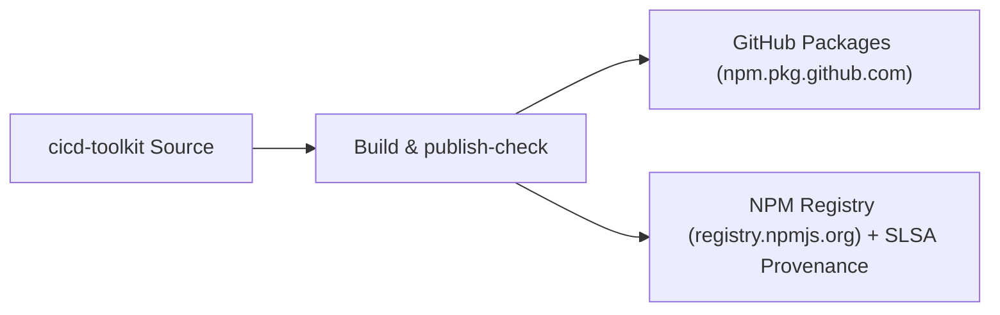

# 📦 Package Registry Publishing Guide

The Ricky Friadi CI/CD Toolkit is distributed as an npm package under the scope `@rickyfriady/cicd-toolkit`. It can be installed as a developer dependency across frontend (Vue, React, Next.js) and backend (Node.js, Bun) projects.

---

## 📌 Registries & Availability



| Registry | Endpoint | Authentication | SLSA Provenance |
| :--- | :--- | :--- | :--- |
| **GitHub Packages** | `https://npm.pkg.github.com/` | `GITHUB_TOKEN` / Personal Access Token | Yes (GitHub Attestation) |
| **NPM Public** | `https://registry.npmjs.org/` | OIDC Trusted Publisher / `NPM_TOKEN` | Yes (`--provenance`) |

---

## 🚀 Consumer Installation Guide

### Option 1: Consuming from GitHub Packages

1. Add a `.npmrc` file in your project's root directory:
```ini
@rickyfriady:registry=https://npm.pkg.github.com
//npm.pkg.github.com/:_authToken=${GITHUB_TOKEN}
```

2. Install via your preferred package manager:
```bash
# Using PNPM
pnpm add -D @rickyfriady/cicd-toolkit

# Using Bun
bun add -d @rickyfriady/cicd-toolkit

# Using NPM
npm install --save-dev @rickyfriady/cicd-toolkit
```

---

### Option 2: Consuming from Public NPM Registry

When published to public npm, no `.npmrc` file is required:
```bash
pnpm add -D @rickyfriady/cicd-toolkit
```

---

## 🛠️ Usage in Consumer Repositories

### 1. Using Pre-configured Dangerfile
In your project's root `dangerfile.ts`:
```typescript
import {
  loadConfig,
  checkPRHygiene,
  checkSecurity,
  checkCodeHealth,
  checkBundleSize,
  checkLicenseAndSecrets,
  checkSAST
} from "@rickyfriady/cicd-toolkit";

const config = loadConfig();

schedule(async () => {
  await checkPRHygiene(config);
  await checkSecurity(config);
  await checkCodeHealth(config);
  await checkLicenseAndSecrets(config);
  await checkBundleSize(config);
  await checkSAST(config);
});
```

### 2. Using Bundle Measure CLI
```bash
pnpm exec cicd-measure-bundle
```

---

## 🔒 Security & Supply Chain Verification
Every publication step runs `scripts/publish-check.ts` prior to uploading assets:
- Verifies package scope and version integrity.
- Ensures required files (`LICENSE`, `README.md`, compiled `dist/`) exist.
- Attaches cryptographic build provenance ensuring binaries were built by GitHub Actions and not tampered with.
