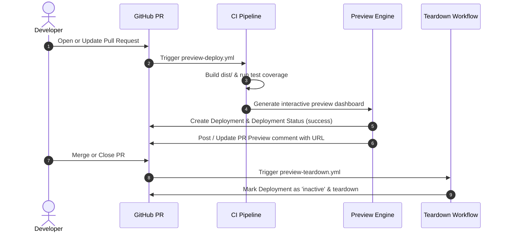

# 🌐 Ephemeral PR Preview Deployments Engine

The PR Preview Deployment Engine provisions an isolated, ephemeral dashboard environment for every pull request opened across repositories utilizing the Ricky Friadi CI/CD Toolkit.

---

## 📌 Architecture & Lifecycle

---

## 🛠️ Dashboard & Contents

Each ephemeral preview packages:
1. **Interactive Metrics Dashboard (`index.html`)**: Summarizing commit SHA, PR number, build timestamp, bundle analysis, and gate statuses.
2. **Live HTML Test Coverage Report (`coverage/`)**: Browsable Istanbul coverage tree showing statement, function, and branch coverage per file.
3. **Production Bundle Breakdown**: Live minified and gzip metrics.

---

## 🔄 Automatic Teardown
To avoid orphaned environments and resources, `.github/workflows/preview-teardown.yml` listens for `pull_request: [closed]`. When triggered, it automatically deactivates the corresponding GitHub Deployment environment.
