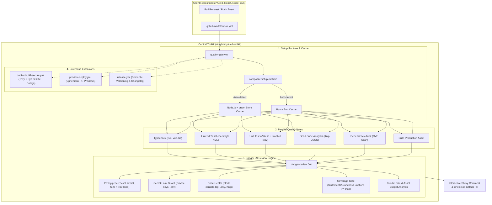

# Enterprise CI/CD Toolkit & Danger Review Engine: Project Summary

Dokumen ini merangkum kapabilitas menyeluruh, arsitektur, standar kualitas, serta spesifikasi dari proyek **`rickyfriady/cicd-toolkit`** (versi `v1.1.1`). Proyek ini dibangun untuk menyediakan pipeline otomatisasi CI/CD dan code review bot Danger JS berstandar industri decacorn yang reusable untuk repository frontend dan backend.

---

## 1. Ringkasan Eksekutif

| Parameter | Spesifikasi / Nilai | Keterangan |
| :--- | :--- | :--- |
| **Nama Proyek** | `cicd-toolkit` | Reusable GitHub Actions & Danger Review Engine |
| **Repository GitHub** | [`rickyfriady/cicd-toolkit`](https://github.com/rickyfriady/cicd-toolkit) | Public / Reusable Action Repo |
| **Versi Rilis Saat Ini** | `v1.1.1` (Tag: `v1`, `v1.1.1`) | Automated semantic release |
| **Lisensi** | MIT License | Open source, bebas digunakan di semua repo client |
| **Package Managers** | `pnpm` (12.15.0) & `bun` (LTS/Stable) | Dynamic auto-detection via lockfile |
| **Runtime Lingkungan** | Node.js Alpine LTS (`lts/*`) & Bun Alpine | Ultra-lightweight & secure containerized execution |
| **OpenSpec Archive** | `2026-10-31-reusable-cicd-danger` | 14/14 tugas selesai dan disinkronkan ke main specs |
| **Lokasi Cadangan Fisik** | `~/.mcp-backups/cicd_toolkit_archive_*.tar.gz` | Arsip terkompresi tanpa node_modules/.git |

---

## 2. Arsitektur Komponen Utama



---

## 3. Matriks Fitur & Modul

### A. Reusable Workflows (`.github/workflows/`)
1. **`quality-gate.yml`**:
   - Menjalankan 6 gerbang kualitas secara terisolasi dengan restore cache dependensi cepat.
   - Dilengkapi `concurrency: cancel-in-progress: true` untuk menghemat menit runner GitHub Actions.
   - Opsional Node version matrix testing.
2. **`docker-build-secure.yml`**:
   - Multi-arch Docker Buildx (`linux/amd64`, `linux/arm64`).
   - Zero-trust Distroless base images.
   - Pemindaian kerentanan container otomatis via **Trivy SARIF**.
   - Pembuatan **SBOM** standar CycloneDX dan SPDX via Syft.
   - Penandatanganan cryptographic container image & attestations secara keyless via **Cosign / Sigstore (OIDC)**.
3. **`preview-deploy.yml`**:
   - Deployment preview ephemeral otomatis untuk setiap branch PR aktif.
   - Menautkan URL live preview dan laporan coverage HTML langsung di komentar bot PR.
   - Pembersihan resource otomatis saat PR ditutup (`closed`).
4. **`release.yml`**:
   - Otomatisasi rilis semantik berdasarkan kaidah *Conventional Commits*.
   - Pembuatan tag Git, updating `CHANGELOG.md`, dan publikasi GitHub Release beserta build assets.

### B. Danger Review Engine (`dangerfile.ts`)
- **PR Hygiene:** Memvalidasi format judul PR (misal `[PROJ-123]` atau `feat:`), panjang deskripsi PR (>50 karakter), dan memberikan peringatan pada PR besar (>400 baris kode).
- **Security Guard:** Memblokir kebocoran file credential (`.pem`, `.key`, `.env`, `id_rsa`) dan memproses temuan CVE kategori *High* atau *Critical* dari dependency audit.
- **Deep Secret Scanner:** Pemindaian diff regex entropi tinggi untuk mencegah kebocoran API Key (AWS, OpenAI, Slack Webhooks, dsb).
- **Code Health & Safety:** Menolak kode yang masih menyisakan `console.log`, `debugger`, atribut inline static `style="..."`, flag test suites yang tertinggal (`it.only`, `test.skip`, `fit`), serta desinkronisasi lockfile.
- **Knip Integration:** Pelaporan visual multi-tabel untuk 13 kategori kode mati (unused exports, unused dependencies, dead files) lengkap dengan nomor baris kode.
- **Coverage Enforcement:** Menolak merge jika test coverage berada di bawah ambang batas (default **80%**).
- **Bundle Size Guard:** Menghitung ukuran asset produksi `dist/` (raw dan gzip) serta memberikan alert jika melebihi anggaran budget.

---

## 4. Panduan Konsumsi di Repository Klien

Cukup tambahkan file `.github/workflows/ci.yml` di repository klien (Vue 3, React, atau Node):

```yaml
name: CI Pipeline

on:
  push:
    branches: [main, staging, development]
  pull_request:
    branches: [main, staging, development]

concurrency:
  group: ${{ github.workflow }}-${{ github.ref }}
  cancel-in-progress: true

jobs:
  quality-gate:
    name: "Enterprise Quality Gate"
    uses: rickyfriady/cicd-toolkit/.github/workflows/quality-gate.yml@v1
    with:
      package-manager: "auto" # 'pnpm' | 'bun' | 'auto'
      node-version: "lts/*"
      coverage-threshold: 80
      run-knip: true
      run-audit: true
      build-script: "build"
      danger-enabled: true
    secrets: inherit
```

---

## 5. Sinkronisasi OpenSpec

Perubahan terkait arsitektur ini telah disinkronkan dan diarsipkan ke dalam repository spesifikasi:
- **Change ID:** `reusable-cicd-danger`
- **Arsip Path:** `openspec/changes/archive/2026-10-31-reusable-cicd-danger/`
- **Spesifikasi Utama (Main Specs):**
  - [`openspec/specs/dangerfile-review-engine/spec.md`](../../openspec/specs/dangerfile-review-engine/spec.md)
  - [`openspec/specs/reusable-quality-pipeline/spec.md`](../../openspec/specs/reusable-quality-pipeline/spec.md)
