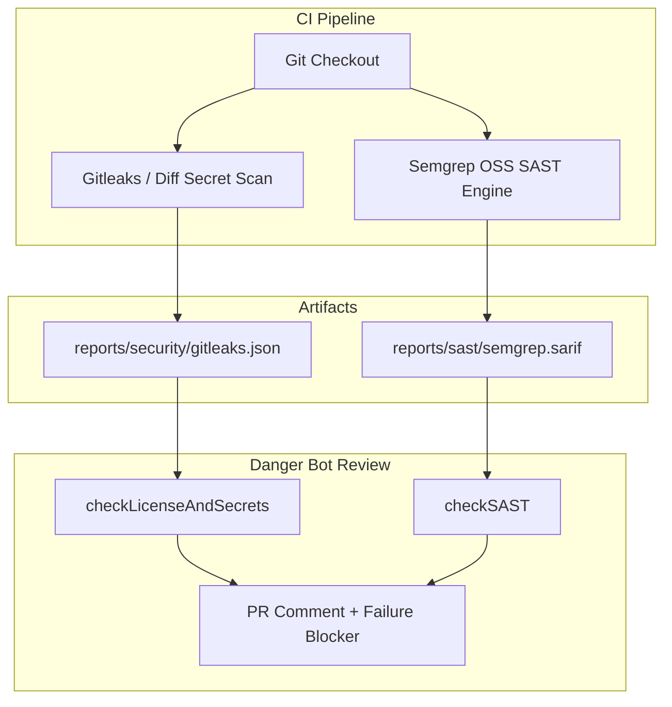

# 🔍 Deep SAST & Hardcoded Secret Scanning

The Ricky Friadi CI/CD Toolkit embeds static application security testing (SAST) and entropy-based credential leakage detection into both the CI quality gates and the Danger JS code review bot.

---

## 📌 Architecture & Layers



---

## 🛡️ Security Capabilities

### 1. Hardcoded Secret & Credential Scanning
Scans pull request code diffs and commit histories against high-entropy regex patterns:
- **Cloud Providers**: AWS Access Key IDs, GCP Service Account JSON keys.
- **AI & SaaS APIs**: OpenAI Secret Keys, Anthropic API Keys, Slack Webhooks, GitHub PATs (`ghp_`, `github_pat_`).
- **Cryptographic Keys**: RSA, EC, and OpenSSH private key headers.
- **Database & Passwords**: Connection string credentials and hardcoded password declarations.

*Action on detection:* Immediate **`fail()`** status blocker on the PR.

### 2. Semgrep OSS SAST Analysis (`danger/rules/sast.ts`)
- Ingests standard OASIS SARIF v2.1.0 (`reports/sast/semgrep.sarif`) or Semgrep JSON reports.
- Checks against OWASP Top 10 guidelines (SQL Injection, Path Traversal, ReDoS, XSS, Unsafe Deserialization).
- Renders an itemized security finding table in the Danger comment.
- Fails the quality gate if high-severity errors are found (`sastFailOnSeverity: "error"` in `.dangerrc.json`).

---

## ⚙️ Configuration (`.dangerrc.json`)

```json
{
  "enforceSecretScanning": true,
  "enforceSast": true,
  "sastFailOnSeverity": "error"
}
```
