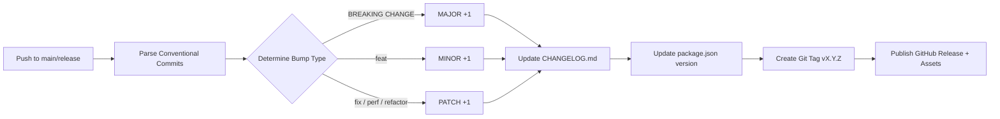

# 🏷️ Automated Semantic Release & Changelog Engine

The Ricky Friadi CI/CD Toolkit includes an automated semantic release and changelog generation engine designed to satisfy fintech and enterprise governance requirements.

---

## 📌 Architecture & How It Works



### 1. Conventional Commits Parsing
The engine inspects commits since the latest Git release tag (`git describe --tags --abbrev=0`):
- `feat(...)?: ...` ➔ **MINOR** bump (`1.0.0` ➔ `1.1.0`)
- `fix(...)?: ...` ➔ **PATCH** bump (`1.0.0` ➔ `1.0.1`)
- `perf(...)?: ...` ➔ **PATCH** bump
- `refactor(...)?: ...` ➔ **PATCH** bump
- `BREAKING CHANGE` or `feat!:` ➔ **MAJOR** bump (`1.0.0` ➔ `2.0.0`)
- `docs:`, `chore:`, `style:`, `test:` ➔ Documentation & internal changes (no bump by default)

### 2. Formatted Markdown Changelog (`CHANGELOG.md`)
Categorizes changes into standard sections:
- `💥 Breaking Changes`
- `✨ Features & Enhancements`
- `🐛 Bug Fixes`
- `⚡ Performance Improvements`
- `♻️ Code Refactoring`
- `📝 Documentation`

Each entry links back to the commit hash and mentions the author handle.

### 3. GitHub Release Publishing
- Generates official GitHub Releases with release notes.
- Packages and attaches production tarball (`cicd-toolkit-vX.Y.Z.tar.gz`) containing built artifacts and licenses.

---

## 🚀 Usage & Workflows

### Automatic Trigger
Triggers whenever commits are pushed or merged into `main`, `master`, or release branches.

### Manual Trigger (Workflow Dispatch)
You can trigger a release run manually via GitHub Actions UI:
- **`dry-run`**: Test version calculation and print release notes without publishing.
- **`force-bump`**: Override calculation with `patch`, `minor`, or `major`.

### Local Testing
```bash
# Dry run calculation
pnpm run release:dry

# Execute release locally
pnpm run release
```
