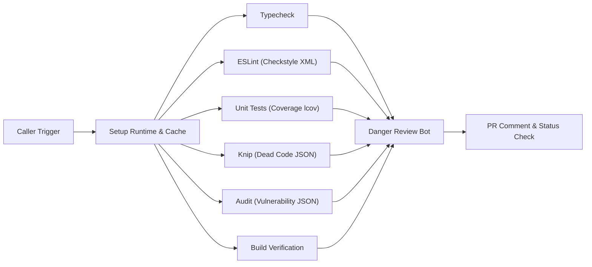
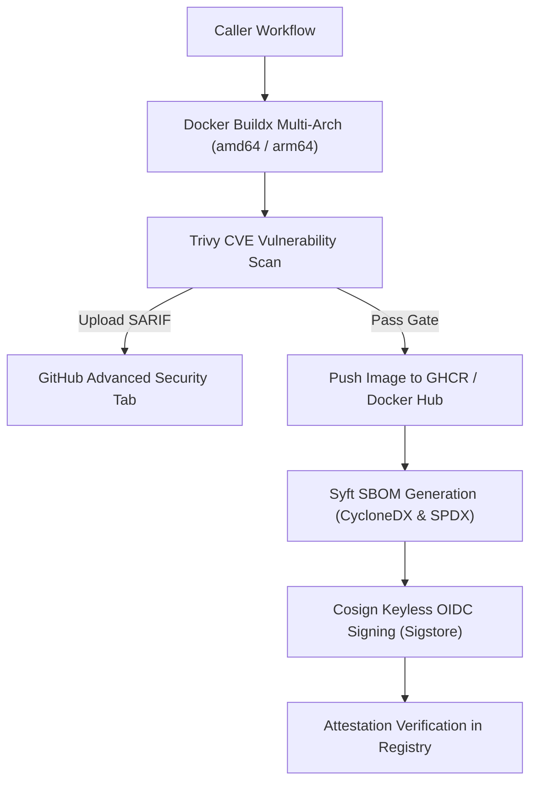

# Reusable Workflows Guide

This guide documents the enterprise reusable GitHub Actions workflows provided by `rickyfriady/cicd-toolkit`. Each workflow is modular, hardened with least-privilege permissions, and designed to be called with a single `uses:` declaration.

---

## 1. Quality Gate & Code Review (`quality-gate.yml`)

Runs automated verification gates and invokes the **Danger JS Review Bot** to generate interactive PR comments.

### Workflow Path
```yaml
uses: rickyfriady/cicd-toolkit/.github/workflows/quality-gate.yml@v1
```

### Flowchart


### Inputs

| Input | Type | Default | Description |
| :--- | :--- | :--- | :--- |
| `package-manager` | `string` | `"auto"` | Package manager to use: `'pnpm'`, `'bun'`, or `'auto'` (detects lockfile). |
| `node-version` | `string` | `"lts/*"` | Node.js version when using pnpm (e.g. `'lts/*'`, `'22.x'`). |
| `pnpm-version` | `string` | `"12.15.0"` | Fallback pnpm version if `packageManager` is omitted in `package.json`. |
| `bun-version` | `string` | `"latest"` | Bun version when using bun. |
| `coverage-threshold` | `number` | `80` | Minimum code coverage percentage required across all metrics. |
| `run-knip` | `boolean` | `true` | Whether to scan for dead code, unused exports, and unlisted dependencies. |
| `run-audit` | `boolean` | `true` | Whether to scan dependency trees for CVE security vulnerabilities. |
| `build-script` | `string` | `"build"` | NPM/Bun script name executed for production build verification. |
| `danger-enabled` | `boolean` | `true` | Whether to run Danger JS PR analysis and sticky commenting. |
| `enable-matrix` | `boolean` | `false` | Whether to run test matrix across multiple Node versions in parallel. |

### Required Permissions in Caller
```yaml
permissions:
  contents: read
  pull-requests: write
  statuses: write
  issues: write
```

### Example Usage (Vue 3 / React / Node.js)
```yaml
name: CI Pipeline

on:
  push:
    branches: [main, master, "feature/**"]
  pull_request:
    branches: ["**"]

concurrency:
  group: ${{ github.workflow }}-${{ github.ref }}
  cancel-in-progress: true

jobs:
  quality-gate:
    name: "Quality Gate"
    uses: rickyfriady/cicd-toolkit/.github/workflows/quality-gate.yml@v1
    with:
      package-manager: "pnpm"
      node-version: "lts/*"
      coverage-threshold: 80
      run-knip: true
      run-audit: true
    secrets: inherit
```

---

## 2. Hardened Container Build, Security Scan & SBOM (`docker-build-secure.yml`)

Multi-architecture container build pipeline featuring **Trivy CVE Scanning**, **Syft SBOM generation**, and **Cosign Keyless Signing** via Sigstore.

### Workflow Path
```yaml
uses: rickyfriady/cicd-toolkit/.github/workflows/docker-build-secure.yml@v1
```

### Pipeline Stages


### Inputs

| Input | Type | Default | Description |
| :--- | :--- | :--- | :--- |
| `image-name` | `string` | *(Required)* | Full image name (e.g. `ghcr.io/org/repo`). |
| `dockerfile` | `string` | `"Dockerfile"` | Path to Dockerfile. |
| `context` | `string` | `"."` | Build context directory. |
| `platforms` | `string` | `"linux/amd64,linux/arm64"` | Target architectures for Buildx. |
| `push` | `boolean` | `true` | Whether to push the image to registry (disable on PRs). |
| `scan-severity` | `string` | `"CRITICAL,HIGH"` | Trivy vulnerability severity threshold. |
| `fail-on-cve` | `boolean` | `true` | Fails the job if CVEs exceeding threshold are found. |
| `generate-sbom` | `boolean` | `true` | Generates CycloneDX & SPDX Software Bill of Materials. |
| `sign-image` | `boolean` | `true` | Signs image & SBOM attestations with Cosign (Keyless). |
| `registry` | `string` | `"ghcr.io"` | Target container registry. |

### Required Permissions in Caller
```yaml
permissions:
  contents: read
  packages: write
  id-token: write      # Required for Cosign Sigstore keyless signing
  security-events: write # Required for Trivy SARIF upload
```

### Example Usage
```yaml
name: Container Release

on:
  push:
    tags: ["v*"]

jobs:
  build-and-sign:
    name: "Build, Scan & Sign"
    uses: rickyfriady/cicd-toolkit/.github/workflows/docker-build-secure.yml@v1
    with:
      image-name: "ghcr.io/${{ github.repository_owner }}/fintech-service"
      dockerfile: "Dockerfile"
      platforms: "linux/amd64,linux/arm64"
      push: true
      scan-severity: "CRITICAL,HIGH"
      fail-on-cve: true
      generate-sbom: true
      sign-image: true
    secrets: inherit
```

---

## 3. PR Ephemeral Preview Deployment (`preview-deploy.yml`)

Deploys pull request preview environments (e.g. Surge, Cloudflare Pages, Vercel) and posts a sticky comment with the live URL on the PR discussion thread.

### Workflow Path
```yaml
uses: rickyfriady/cicd-toolkit/.github/workflows/preview-deploy.yml@v1
```

### Inputs

| Input | Type | Default | Description |
| :--- | :--- | :--- | :--- |
| `build-command` | `string` | `"pnpm run build"` | Build command executed before deployment. |
| `dist-directory` | `string` | `"dist"` | Directory containing static production assets. |
| `preview-domain` | `string` | `""` | Target domain or URL prefix for preview environment. |
| `environment-name` | `string` | `"pr-preview"` | GitHub Environment name for deployment tracking. |

### Example Usage
```yaml
name: Preview Deployment

on:
  pull_request:
    types: [opened, synchronize, reopened]

jobs:
  preview:
    uses: rickyfriady/cicd-toolkit/.github/workflows/preview-deploy.yml@v1
    with:
      build-command: "pnpm run build"
      dist-directory: "dist"
    secrets: inherit
```

---

## 4. Automated Semantic Release (`release.yml`)

Inspects Conventional Commits on merge to `master`/`main`, determines the semantic version bump (`major`, `minor`, `patch`), generates a changelog, cuts a Git Tag, and publishes a GitHub Release.

### Workflow Path
```yaml
uses: rickyfriady/cicd-toolkit/.github/workflows/release.yml@v1
```

### Inputs

| Input | Type | Default | Description |
| :--- | :--- | :--- | :--- |
| `target-branch` | `string` | `"master"` | Branch triggering the release pipeline. |
| `publish-npm` | `boolean` | `false` | Whether to publish package to NPM registry. |
| `dry-run` | `boolean` | `false` | Run semantic analysis without publishing release or tag. |

### Example Usage
```yaml
name: Release

on:
  push:
    branches: [master]

jobs:
  release:
    uses: rickyfriady/cicd-toolkit/.github/workflows/release.yml@v1
    with:
      target-branch: "master"
      publish-npm: false
    secrets: inherit
```
